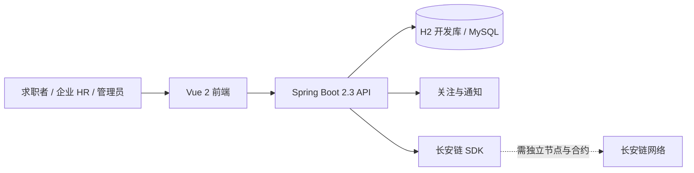

# 智链诚聘：项目优化分析与简历路线

> 分析日期：2026-10-27。本文基于当前仓库静态代码审查，以及此前在 Windows、JDK 17、Node.js 22 下的克隆、安装、构建和启动检查。文中的改进项是待开发计划，不代表已经实现，也不代表已经完成真实链节点或生产环境验收。

## 1. 项目现在是什么样

智链诚聘是一个前后端分离的招聘学习项目：Vue 前端提供职位、企业、简历、投递、面试及后台管理页面；Spring Boot 后端提供对应接口、权限注解、持久化和通知逻辑。代码中还集成了长安链 SDK、职位哈希计算、上链调用和链记录，但默认开发配置关闭链服务。

| 维度 | 当前代码证据 | 当前边界 |
| --- | --- | --- |
| 技术栈 | [pom.xml](../recruit-sys/pom.xml) 使用 Spring Boot 2.3.3、Java 8 目标字节码、MyBatis-Plus 3.4；[package.json](../package.json) 使用 Vue 2.7、Vue CLI 3、Vuex | 旧框架和第三方 starter 的兼容性需要梳理；不能只修改版本号 |
| 核心业务 | [ApplicationController](../recruit-sys/src/main/java/com/recruit/controller/ApplicationController.java)、职位、企业和面试控制器包含业务接口 | 有业务模块，不等于全链路、权限边界和异常流程已经验收 |
| 开发启动 | [application-dev.yml](../recruit-sys/src/main/resources/application-dev.yml) 使用 H2 内存库并关闭链服务 | 重启后数据重新初始化；H2 兼容模式不等同于 MySQL 生产环境 |
| 区块链 | [ChainServiceImpl](../recruit-sys/src/main/java/com/recruit/chain/service/impl/ChainServiceImpl.java) 包含 SDK 合约调用；[PositionHashUtil](../recruit-sys/src/main/java/com/recruit/chain/util/PositionHashUtil.java) 计算 SHA-256 | 尚未在本次审查中连接真实链节点验证；现有一致性校验主要比较本地记录，不能证明已实时查询链上哈希 |
| 验证基础 | 存在 [ChainServiceTest](../recruit-sys/src/test/java/com/recruit/chain/ChainServiceTest.java) 等测试文件；仓库有启动说明 | 测试文件存在不等于全部测试通过，也不等于链、MySQL 或业务端到端验收通过 |

## 2. 先解决影响可信度的具体问题

以下是根据当前代码识别的改进优先级。风险判断来自静态审查，涉及实际表现时应补充运行验证。

### P0：身份、数据与业务正确性

1. **隔离当前用户和通知状态。** [UserController.login](../recruit-sys/src/main/java/com/recruit/controller/UserController.java) 把用户写入 `SingleUtil.userDO`；[FollowController](../recruit-sys/src/main/java/com/recruit/controller/FollowController.java) 又读取它，相关 `HashMap` 也保存在 [SingleUtil](../recruit-sys/src/main/java/com/recruit/common/util/SingleUtil.java) 中。多个用户或多个实例下可能相互覆盖、丢消息，进程重启也会丢状态。应从请求上下文取得当前用户，以数据库保存关注关系与通知，禁止用全局可变字段代表当前用户。
2. **补齐对象级权限。** [ApplicationController](../recruit-sys/src/main/java/com/recruit/controller/ApplicationController.java) 的部分接口接收请求体中的用户、HR、企业 ID 或路径参数，控制器及对应 [ApplicationServiceImpl](../recruit-sys/src/main/java/com/recruit/service/impl/ApplicationServiceImpl.java) 中没有看到完整的逐记录归属校验。应逐接口检查身份来源、求职者对自己简历的访问、HR 对所属企业和职位的管理范围，并用跨用户、跨企业请求验证。不能仅凭角色注解断言不存在越权。
3. **明确投递和面试状态机。** 当前申请审核接口更新状态后直接插入面试记录；撤销申请的注释要求“仅未处理可撤销”，但删除路径未见该状态判断。应定义合法状态和转换条件，在事务中完成状态变更及面试创建，结合条件更新与数据库唯一约束处理重复请求和并发。
4. **停止直接执行破坏性迁移。** [migrate_chain.sql](../recruit-sys/sql/migrate_chain.sql) 包含 `DROP TABLE IF EXISTS chain_record`，并直接添加职位字段；[recruit.sql](../recruit-sys/sql/recruit.sql) 已包含这些职位字段。重复执行可能删除链记录或遇到字段已存在。应先备份，再引入版本化迁移，例如 Flyway；基于现有库和全新库分别验证，禁止盲目顺序执行所有脚本。
5. **收紧生产配置与数据处理。** [application.yml](../recruit-sys/src/main/resources/application.yml) 有开发用默认令牌密钥，[application-prod.yml](../recruit-sys/src/main/resources/application-prod.yml) 的链节点及证书依赖环境配置；应让生产环境缺少密钥或证书时明确启动失败，开发演示账号只存在于开发数据中。上传简历应校验格式、大小和内容，控制下载权限，避免把简历、联系方式或完整业务 JSON 写到链上和日志中。
6. **检查开发库重复初始化。** [application-dev.yml](../recruit-sys/src/main/resources/application-dev.yml) 在 H2 连接 URL 中使用 `INIT=RUNSCRIPT`，而 [schema.sql](../recruit-sys/src/main/resources/db/schema.sql) 包含普通 `INSERT`。H2 的 `INIT` 会在建立连接时执行；连接池创建额外连接时可能重复插入并触发主键冲突。应以多连接复现后，将建表和演示数据初始化改为应用启动时执行一次，并覆盖重启和并发连接场景。参考 [H2 连接初始化说明](https://h2database.com/html/features.html)。

**验收建议：** 两名求职者和两个企业 HR 同时登录，分别执行投递、关注、审核、撤销与通知；对其他人的简历和其他企业职位执行读写尝试，检查服务端拒绝；对同一申请并发审核和重复提交，检查只产生一次合法结果。迁移在备份库、空库和已有库分别验证。

### P0：让“区块链可信招聘”经得起追问

1. **读取真实链上值。** [verifyConsistency](../recruit-sys/src/main/java/com/recruit/chain/service/impl/ChainServiceImpl.java) 当前计算职位哈希后与数据库中的 `chain_record.data_hash` 比较；`queryFromChain` 并未被这一校验路径调用。[PositionServiceImpl](../recruit-sys/src/main/java/com/recruit/service/impl/PositionServiceImpl.java) 返回的 `chainHash` 来自职位表。应定义合约查询接口，从链上按业务键读取已确认的哈希，再与本地规范化数据比较，区分一致、不一致、无记录、链不可用和交易未确认。
2. **重新设计写链与数据库的边界。** 当前职位创建和 `uploadToChain` 都有事务注解，内层捕获后重新抛出异常，外层捕获并尝试标记失败；在共享事务传播下可能触发回滚标记，导致“上链失败仍保存职位”的注释与实际提交结果不一致，需要集成复现。建议先在本地事务写入职位和待处理事件，再异步上链、持久化结果、失败重试与对账；用唯一业务键和数据库约束保障幂等。
3. **校验确认与重试信息。** SDK 返回成功、交易被打包和业务数据可查询是不同阶段；重试应记录并回写真实交易 ID，避免单靠进程内查询判断重复上链。当前 [migrate_chain.sql](../recruit-sys/sql/migrate_chain.sql) 的 `idx_idempotent_key` 是普通 `KEY`，注释称“唯一索引”，并未提供数据库唯一性保证。
4. **只存必要的摘要。** 当前上链调用包含 `biz_data`。建议将链上内容限制为版本化、规范化的业务摘要及必要索引；原始职位数据保留在数据库，求职者简历和联系方式不写入不可撤销的链上记录。

**验收建议：** 在有合约和节点的测试环境中保存一条职位，分别验证链上查询、改动本地字段后的不一致、节点断开、超时后重试、并发重复提交及恢复对账；保存交易 ID、链上查询结果、日志和测试报告。没有真实节点时，简历只能写“实现了 SDK 对接代码和本地哈希计算”，不能写“已验证链上防篡改”。

### P1：招聘业务做出一个完整闭环

优先把“求职者投递 → 企业审核 → 安排面试 → 状态通知 → 求职者查看结果”做完整，而不是同时堆积很多页面。建议补齐职位上下架与有效期、重复投递约束、申请撤销、面试改期、状态时间线和操作日志；设计角色和企业归属，明确每种状态允许的操作。搜索先做分页、分类、城市和薪资筛选，基于真实 SQL 与索引执行计划优化，再考虑 Elasticsearch 等组件。

**验收建议：** 准备一套脱敏演示数据，记录两个角色的完整操作过程；覆盖正常、重复投递、非法状态转换、无权限与服务重启场景。输出接口文档、数据字典、演示截图和一条可以复现的验收脚本。

### P1：运行、测试和交付

- 增加 Maven Wrapper、明确 Node 版本与包管理器，提供 Windows 和 macOS/Linux 的启动说明；保留 H2 快速体验，同时提供 Docker Compose 的 MySQL 模式。新增迁移、容器配置后分别在空库和已有库演练。
- 增加 GitHub Actions：后端编译和有意义的单元/集成测试、前端依赖安装与构建、基础代码检查；测试数据库可使用 Testcontainers，在 CI 有 Docker 的条件下运行。将报告和覆盖率作为构建产物，而不是先承诺覆盖率数字。
- 在关键链路补充结构化日志、请求追踪 ID、健康检查和必要指标；日志不记录密码、令牌和简历全文。仅在有实际环境和基线时引入 Prometheus/Grafana。
- 用 OpenAPI 说明认证、请求参数、错误码和分页；提供架构图、部署图、演示数据说明以及可复现的登录与业务流程。

### P2：按需求引入现代能力

- **职位推荐与搜索：** 先做职位条件过滤、排序及搜索日志；再基于明确的规则或离线数据做可解释的匹配推荐，给出匹配理由与人工调整入口。没有真实数据和评估集时，不宣称推荐准确率。
- **AI 辅助：** 可考虑简历解析、职位信息抽取、面试问题建议；先做用户授权、敏感信息处理、来源提示、失败回退和人工确认。AI 输出不直接决定录用结果；没有标注数据与离线评测时不宣称模型效果。
- **异步消息与缓存：** 先保证数据库事务和通知可靠，再按可观测瓶颈选择 Redis 或消息队列。引入后需要解释重复消费、失败重试、一致性及运维成本。

## 3. 与当前技术栈的差距和升级方案

本节记录截至 2026-10-27 的官方资料；具体依赖版本应在开始升级时重新核验。优先选择仍受支持且生态兼容的组合，并在升级前保存可运行基线。

| 方面 | 现状 | 建议路线 | 主要迁移点 |
| --- | --- | --- | --- |
| Java / Spring | Java 8 目标、Spring Boot 2.3.3 | 先用 JDK 17 或 21 建立基线，完成 Boot 2.7 过渡与兼容性审计，再进入受支持的 Boot 3.x；评估依赖成熟度后再考虑 Boot 4.x | `javax.*` 到 `jakarta.*`、Spring Security、Jackson、MyBatis-Plus、`lin-cms-spring-boot-starter` 和长安链 SDK 兼容性，均需实际编译与回归 |
| 前端 | Vue 2.7、Vue CLI 3、Vuex | 渐进迁移到 Vue 3、Vite、TypeScript、Pinia 和兼容 Vue 3 的组件库 | 逐页面梳理 Element UI、富文本、图表、Vuex 插件及第三方插件；先迁移登录和职位闭环，避免一次性重写 |
| Node | README 的最低版本是 Node 18.12；本机曾使用 Node 22 构建 | 新开发环境优先使用当前受支持的 Node LTS，例如 Node 24；针对现有 Vue CLI 项目先验证兼容性，再锁定实际可用版本 | Node 18 已结束维护；升级后验证 `npm ci --legacy-peer-deps`、启动、构建，逐步消除旧 peer dependency 冲突 |
| 数据与交付 | H2 演示和 MySQL 脚本，未建立统一的版本化迁移 | Flyway + MySQL 8、容器化本地依赖、CI；只在出现瓶颈后增加缓存或消息队列 | 数据备份、重复执行、MySQL/H2 方言差异、兼容回滚与密钥配置 |

官方参考：[Spring Boot 4 系统要求](https://docs.spring.io/spring-boot/system-requirements.html)、[Spring Boot 3 系统要求](https://docs.spring.io/spring-boot/3.5/system-requirements.html)、[Spring Boot 3 迁移指南](https://github.com/spring-projects/spring-boot/wiki/Spring-Boot-3.0-Migration-Guide)、[Vue 2 结束维护](https://v2.vuejs.org/eol/)、[Vue 工具链](https://vuejs.org/guide/scaling-up/tooling)、[Node.js 发布状态](https://nodejs.org/en/about/previous-releases)、[Node.js 结束维护版本](https://nodejs.org/en/about/eol)。Spring Boot 4 要求至少 Java 17；能否用于本项目取决于上述依赖的实际兼容性。

## 4. 建议按阶段实施

| 阶段 | 交付 | 完成标准 |
| --- | --- | --- |
| 第 1 阶段：安全与正确性 | 当前用户隔离、对象归属检查、申请状态机、非破坏性迁移 | 双用户越权、重复投递、并发审核、迁移重复运行均有可复现验证 |
| 第 2 阶段：招聘闭环 | 求职者、HR 和管理员的核心操作及通知 | 一套演示数据从职位创建到面试结果完成闭环，异常路径有记录 |
| 第 3 阶段：可信存证 | 可查询的链上摘要、状态机、重试、幂等、对账 | 有真实节点和合约的成功、失败、超时、重试与篡改校验记录 |
| 第 4 阶段：工程化与升级 | CI、容器、接口文档、依赖升级和关键回归 | 干净环境按文档启动；CI 结果、测试报告和迁移说明可查看 |
| 第 5 阶段：差异化 | 搜索、推荐或 AI 辅助，按实际招聘场景选择 | 有真实可复现的效果评价、失败处理和人工控制 |

建议先把前两阶段完成到可演示程度，再选链上存证或推荐中的一项深入。阶段是依赖关系，不承诺固定工期；每一项均应先建立基线、再实施、最后记录可复现证据。

## 5. 简历怎么写才有说服力

### 当前可以据代码描述的内容

> 智链诚聘｜招聘管理系统｜Spring Boot、MyBatis-Plus、Vue 2、MySQL、长安链 SDK
>
> 项目包含职位、企业、简历、投递及面试管理模块；实现职位信息 SHA-256 哈希计算，并编写长安链 SDK 调用及链记录相关代码。提供 H2 开发配置与项目启动文档。

这段是项目代码范围描述。具体写“负责”“独立设计”还是“参与”，应按本人实际工作填写。不要把代码中存在的接口描述成已完成生产部署或真实链验收。

### 优化完成后可按证据补充的表达模板

- **权限与状态机：** 实现求职者与企业 HR 的数据归属校验及投递状态流转；通过 `[测试场景数及结果]` 验证重复请求和跨用户访问。方括号由实际结果替换。
- **可靠上链：** 使用 `[实际采用的方案]` 管理待上链任务、重试和对账，在 `[节点/合约环境]` 验证 `[成功、失败及恢复场景]`。真实链未验证前不要写“防篡改已落地”。
- **性能优化：** 针对 `[接口和数据规模]` 分析执行计划并调整 `[索引或查询]`，在 `[硬件、并发数、测试工具]` 下记录优化前后 `[P95 延迟/吞吐量]`。不要使用估算数字冒充实测。
- **工程交付：** 建立 `[实际 CI 工具]` 流水线，覆盖 `[实际通过的检查]`，并提供 `[部署方式]` 和可复现演示。

## 6. 完成后应保留的证据

1. GitHub 的可运行 README、接口文档、架构图、数据库迁移记录和清晰的提交历史。
2. CI 运行链接，以及覆盖关键权限、状态流转和异常场景的测试结果。
3. 前后端完整演示视频或截图；涉及区块链时同时展示节点、交易 ID 和链上查询结果。
4. 性能报告必须记录数据量、机器、工具、并发数、采样方法、优化前后结果和复测命令。
5. 在简历中区分个人贡献、团队工作、已完成和计划内容；对任何技术亮点都能讲清楚问题、方案、取舍、失败处理与验证方式。
